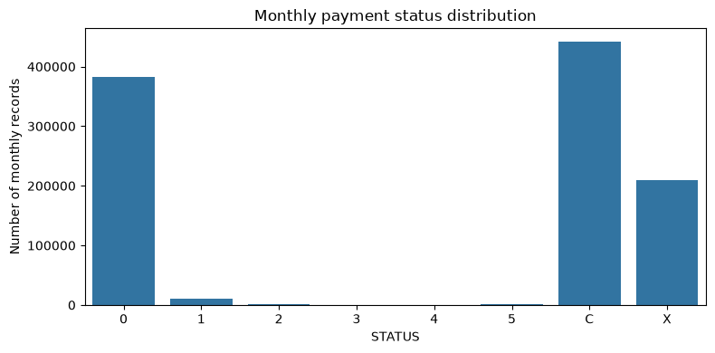
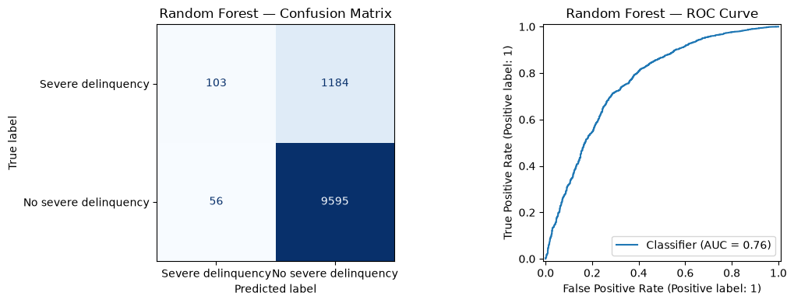
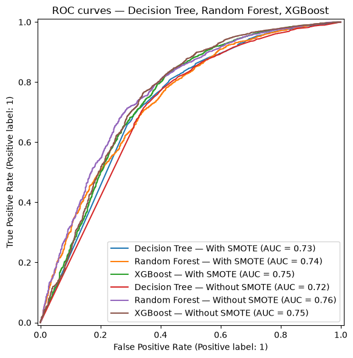
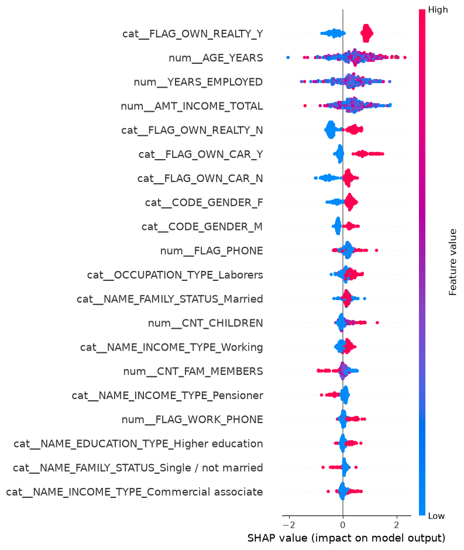

# Credit Card Approval Prediction (MSc Thesis)

This repository contains the code and experiments from my MSc thesis on predicting credit card delinquency risk using machine learning. I also ported the full workflow to a standalone [Kaggle Notebook](https://www.kaggle.com/code/tomaspeltekis/credit-card-approval) so anyone can run or reproduce it directly in the browser.

## About the Project

The goal of this study is to evaluate tree-based ensemble models (**Decision Tree**, **Random Forest**, and **XGBoost**) on credit card application data, examine how **SMOTE** affects imbalanced credit risk datasets, and use **SHAP** to understand what actually drives the model's predictions.

### Dataset & Target Definition

The project uses the well-known Credit Card Approval dataset (`application_record.csv` and `credit_record.csv`). Because the public dataset doesn't include a direct "approved/rejected" label from a bank, we build a creditworthiness target from each customer's monthly repayment history (`STATUS`):

- **Good standing (`1`):** Customers with statuses `C` (paid off), `X` (no loan for the month), or `0` (1–29 days past due).
- **Delinquent / High risk (`0`):** Customers who have ever fallen 30+ days past due (`STATUS` in `1`, `2`, `3`, `4`, or `5`).

*(Note on Target Coding Convention: In the original MSc thesis notebook `notebooks/Credit_Card_Approval_Prediction.ipynb`, class `1` denotes good standing and `0` denotes severe delinquency to match the thesis text. In the extended multi-dataset study under `research_paper/`, the target polarity is inverted so that `y = 1` consistently denotes the minority **Default / Severe Delinquency** class across all three benchmark datasets—Credit Card Approval, UCI Taiwan Credit Default, and Statlog German Credit—aligning predicted probabilities with standard Probability of Default $PD = P(Y=1)$ and minority default recall).*

Since `credit_record.csv` has multiple monthly rows per person, I aggregated the history to **one row per customer `ID`** before merging with `application_record.csv`. This prevents the same applicant from appearing in both the training and test sets.

---

## Methodology & Pipeline

1. **Feature Engineering:** Converted raw day counts (`DAYS_BIRTH`, `DAYS_EMPLOYED`) into `AGE_YEARS` and `YEARS_EMPLOYED`, replacing the `365243` pensioner/unemployed placeholder with missing values to be imputed properly.
2. **Train/Test Split:** 70% training / 30% test split (`stratify=y`, `random_state=1024`).
3. **Preprocessing:** Median imputation for numeric features, mode imputation + one-hot encoding for categorical features inside a `ColumnTransformer`.
4. **Handling Class Imbalance (SMOTE):** Around 88% of applicants fall into class `1`. To avoid data leakage, **SMOTE is applied strictly inside the training folds** during cross-validation (`imblearn.pipeline.Pipeline`), leaving the validation and test sets untouched.
5. **Model Tuning:** 5-fold Stratified Cross-Validation (`GridSearchCV` optimizing for `roc_auc`).

---

## Results

Below is a comparison of the three models trained with the thesis hyperparameters, both **with** and **without** SMOTE on the training folds:

| Experiment | CV ROC-AUC | Test Accuracy | Precision (Class 1) | Recall (Class 1) | F1 (Class 1) | Macro-F1 | Test ROC-AUC |
| :--- | :---: | :---: | :---: | :---: | :---: | :---: | :---: |
| **Random Forest (No SMOTE)** | **0.7282** | 0.8866 | 0.8902 | **0.9942** | **0.9393** | 0.5409 | **0.7642** |
| **XGBoost (No SMOTE)** | 0.7097 | **0.8871** | 0.9058 | 0.9733 | 0.9383 | 0.6363 | 0.7529 |
| **XGBoost (With SMOTE)** | 0.7097 | 0.8692 | 0.9162 | 0.9374 | 0.9267 | **0.6590** | 0.7461 |
| **Random Forest (With SMOTE)** | 0.7180 | 0.8782 | 0.9038 | 0.9647 | 0.9332 | 0.6205 | 0.7394 |
| **Decision Tree (With SMOTE)** | 0.6851 | 0.8430 | **0.9163** | 0.9048 | 0.9105 | 0.6367 | 0.7298 |
| **Decision Tree (No SMOTE)** | 0.6859 | 0.8653 | 0.9064 | 0.9450 | 0.9253 | 0.6221 | 0.7170 |

**What stands out:**
- **Random Forest without SMOTE** gives the best overall ranking performance (**0.7642 ROC-AUC**), though it heavily favors the majority class.
- **XGBoost with SMOTE** achieves the best balance across both classes (**0.6590 Macro-F1**), trading a bit of majority-class recall to catch more high-risk applicants.

---

## Visuals

### Monthly Payment Status Distribution


### Best Model — Confusion Matrix & ROC Curve


### ROC Curves Across All Models


### SHAP Feature Importance (XGBoost)
Using `shap.TreeExplainer` on the XGBoost model to inspect how applicant features (employment length, age, income, family status, etc.) push predictions toward high or low risk:



---

## Project Structure

- `notebooks/Credit_Card_Approval_Prediction.ipynb` — Main MSc thesis notebook with all outputs and plots rendered.
- `credit-card-approval.ipynb` — Copy of the notebook configured for Kaggle.
- `figures/` — Exported charts from the thesis notebook run.
- `results/model_comparison_results.csv` — Summary table of thesis metrics and hyperparameters.
- `research_paper/` — Extended multi-dataset benchmark scripts, probability calibration sensitivity analysis, and SHAP stability / feature-ablation experiments (comparing Baseline, SMOTE, ADASYN, and Cost-Sensitive Learning across Credit Card Approval, UCI Taiwan Credit Default, and Statlog German Credit).
- `requirements.txt` — Python packages needed to run the notebook and benchmark scripts locally.

## How to Run

**On Kaggle:**  
You can view and fork the notebook directly here: [kaggle.com/code/tomaspeltekis/credit-card-approval](https://www.kaggle.com/code/tomaspeltekis/credit-card-approval).

**Locally:**
1. Clone the repo and install the dependencies:
   ```bash
   git clone https://github.com/dppel/MIS_Thesis.git
   cd MIS_Thesis
   pip install -r requirements.txt
   ```
2. Download `application_record.csv` and `credit_record.csv` from the [Kaggle dataset](https://www.kaggle.com/datasets/rikdifos/credit-card-approval-prediction) and place them in a `data/` folder.
3. Open `notebooks/Credit_Card_Approval_Prediction.ipynb` in Jupyter or VS Code, or run the extended research benchmark scripts:
   ```bash
   python research_paper/run_experiments.py
   python research_paper/run_reviewer_validations.py
   python research_paper/run_ablation_check.py
   python research_paper/generate_figures.py
   python research_paper/verify_manuscript_tables.py
   ```
